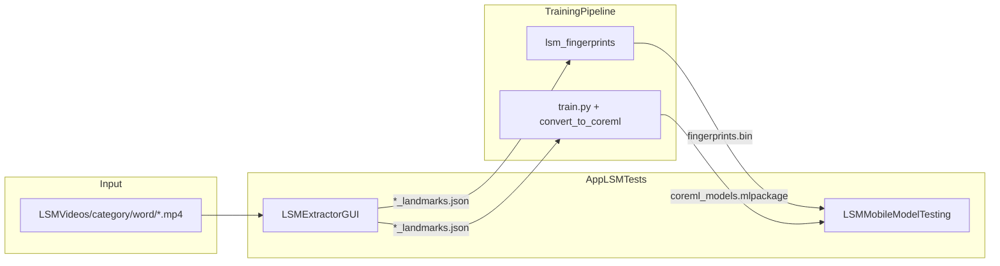

# AGENTS.md — AppLSMTests

> **Audience:** AI-assisted and agentic development. For human onboarding, see [README.md](./README.md).
>
> **Sibling repo:** [TrainingPipeline/AGENTS.md](../TrainingPipeline/AGENTS.md) — Python Fase 1 + Fase 2 training pipeline.

This repo contains **Swift apps** for LSM (Lengua de Señas Mexicana):

- **LSMExtractorGUI** (macOS) — batch landmark extraction from video via Apple Vision
- **LSMMobileModelTesting** (iOS) — live camera inference (Fase 1 fingerprint+DTW or Fase 2 Core ML)

---

## Goals and success metrics

| Phase | Goal | Success metric |
|---|---|---|
| **Extractor** | Produce training-ready landmark JSON from organized videos | Correct `category/word/` discovery; mirrored output layout |
| **Fase 1 mobile** | On-device fingerprint matching | Parity with Python (`Phase1ParityCheck`); latency <200ms |
| **Fase 2 mobile** | On-device Core ML inference | Top-5 predictions; buffer fills to 85 frames before inference |

**Vocabulary:** 221 words defined in TrainingPipeline `themes.json`; extractor infers category/word from folder path only.

---

## Ecosystem architecture



---

## Critical invariants (do not break)

| Contract | Value / rule |
|---|---|
| Landmark vector | 135 dims/frame: `[0:42]` left hand, `[42:84]` right hand, `[84:135]` pose |
| Sequence length | 85 frames after interpolation (matches TrainingPipeline) |
| JSON frame keys | `frame`, `timestamp_ms`, `leftHand`, `rightHand`, `pose`; Y=0 at top (Swift applies `1.0 - y` on save) |
| Extractor input | `{root}/{category}/{word}/*.mp4` — no `themes.json` matching |
| Extractor output | `{outputRoot}/{category}/{word}/{base}_landmarks.json`, optional `{base}_overlay.mp4` |
| Manifest | `dataset_manifest.json` — schema in `Models.swift` (`DatasetManifest`) |
| Fase 1 binary | `fingerprints.bin` magic `0x4C534D46`, version 1 — loaded by `FingerprintMatcher.swift` |
| Fase 1 DTW | Sakoe-Chiba band `dtwRadius=10` — mirrors Python `DTW_RADIUS` |
| Inference buffer | Circular buffer up to 170 frames; uses last 85; inference every 15 frames |

---

## File index — if task X, read Y

### LSMExtractorGUI (macOS)

| Task | Files |
|---|---|
| App entry | `LSMExtractorGUI/LSMExtractorApp.swift` |
| UI | `LSMExtractorGUI/ContentView.swift` |
| Vision + video I/O | `LSMExtractorGUI/LandmarkExtractor.swift` |
| Batch orchestration | `LSMExtractorGUI/BatchProcessor.swift` |
| Path discovery + manifest | `LSMExtractorGUI/DatasetScanner.swift` |
| Types (JSON, manifest, report) | `LSMExtractorGUI/Models.swift` |
| Xcode project | `LSMExtractorGUI/LSMExtractorGUI.xcodeproj/` |

### LSMMobileModelTesting (iOS)

| Task | Files |
|---|---|
| App entry | `LSMMobileModelTesting/LSMInferenceApp.swift` |
| UI (camera + predictions) | `LSMMobileModelTesting/ContentView.swift` |
| Inference pipeline | `LSMMobileModelTesting/LandmarkPipeline.swift` (`AVAILABLE_MODELS`) |
| Camera | `LSMMobileModelTesting/CameraManager.swift` |
| Fase 1 preprocessing | `LSMMobileModelTesting/SequencePreprocessor.swift` |
| Fase 1 fingerprint | `LSMMobileModelTesting/FingerprintExtractor.swift` |
| Fase 1 matching | `LSMMobileModelTesting/FingerprintMatcher.swift` |
| Shared constants | `LSMMobileModelTesting/LSMConstants.swift` |
| DEBUG parity check | `LSMMobileModelTesting/Phase1ParityCheck.swift` |
| Bundled model | `LSMMobileModelTesting/coreml_models.mlpackage/` |
| Class labels | `LSMMobileModelTesting/classes.json` |
| Golden fixture | `LSMMobileModelTesting/golden_sequence.json` |
| Xcode project | `LSMMobileModelTesting/LSMMobileModelTesting.xcodeproj/` |

---

## Technologies and dependencies

| Stack | Details |
|---|---|
| Language | Swift 5, SwiftUI |
| Vision | `VNDetectHumanHandPoseRequest`, `VNDetectHumanBodyPoseRequest` |
| Media | AVFoundation (extractor: reader/writer; mobile: AVCaptureSession) |
| ML | Core ML (Fase 2), custom DTW matcher (Fase 1) |
| Platforms | macOS 15.7+ (extractor), iOS 26.2+ deployment target (mobile) |
| IDE | Xcode with Apple SDKs |

**Build note:** Requires macOS + Xcode. Cannot build or run on Linux CI without a Mac runner.

---

## Common workflows

### Extract landmarks (macOS)

1. Open `LSMExtractorGUI/LSMExtractorGUI.xcodeproj` in Xcode
2. Select input root (`LSMVideos/`), output root (`LSMVideosOutput/`)
3. Optional: load existing `dataset_manifest.json`; toggle overlay off for JSON-only mode
4. Run **Procesar**

### Update Fase 1 on iOS

Production bin from LSMOutput (not the tiny sample from `generate_sample_bin.py`):

```bash
cd ../TrainingPipeline/lsm_fingerprints
python build_db.py --dataset ../LSMOutput --output ./fingerprints.npz --export-bin ./fingerprints.bin --min-videos 2
```

Copy `fingerprints.bin` into LSMMobileModelTesting Xcode target. See [Phase 1 iOS validation checklist](#phase-1-ios-validation-checklist).

Baseline reference: [TrainingPipeline/AGENTS.md — Phase 1 baseline](../TrainingPipeline/AGENTS.md#phase-1-baseline-lsmoutput)

### Add Core ML model (Fase 2)

1. Export from TrainingPipeline: `convert_to_coreml.py`
2. Drag `.mlpackage` + `classes.json` into Xcode target
3. Register in `LandmarkPipeline.swift` → `AVAILABLE_MODELS`

### Run Fase 1 parity check

Build LSMMobileModelTesting in **Debug** on device/simulator — `Phase1ParityCheck` runs automatically against `golden_sequence.json`.

---

## Prerequisites from TrainingPipeline

Before iOS Fase 1 validation, confirm TrainingPipeline Part A is complete:

| Artifact | Path | Status (2026-06-17) |
|---|---|---|
| Production `fingerprints.bin` | `TrainingPipeline/lsm_fingerprints/fingerprints.bin` | Built (307 classes, 1934 videos) |
| LOO baseline logged | [TrainingPipeline/AGENTS.md](../TrainingPipeline/AGENTS.md#phase-1-baseline-lsmoutput) | Top-1 6.57%, Top-5 16.18% |
| Unit tests | `lsm_fingerprints/tests/test_all.py` | 8/8 passed |

Do **not** use `generate_sample_bin.py` for device validation — it only contains 2 dummy classes.

---

## Phase 1 iOS validation checklist

Execute on **macOS + Xcode + physical device** (recommended for camera latency).

### Integration status (2026-06-06)

| ID | Item | Status |
|---|---|---|
| B1 | Production `fingerprints.bin` in app folder | Done — local copy, gitignored |
| B2 | Debug parity + load log | Offline OK — golden max diff 0.0; confirm `✓ Parity check passed` + `307 clases, 1934 videos` on Debug build |
| B3 | Live test matrix | **Pending device** — procedure in README |
| B4 | Latency from debug panel | **Pending device** — Cosine/DTW split wired; Python desktop ~930 ms reference |
| B5 | Release smoke | **Pending device** — one Release build after Debug passes |

**Code changes applied (latency mitigation):**

- Async `fingerprints.bin` parse in `LandmarkPipeline.loadModel` (background queue + loading UI)
- Fingerprint `match()` on detached task; UI updates on `@MainActor`
- `LSMConstants.dtwRadius = 10` (Sakoe-Chiba band in `FingerprintMatcher.dtwDistance`)
- Debug panel: Cosine ms + DTW ms columns

### B1 — Copy production bin

- [x] Source: `../TrainingPipeline/lsm_fingerprints/fingerprints.bin` (from LSMOutput build)
- [x] Copy to `LSMMobileModelTesting/LSMMobileModelTesting/fingerprints.bin` (synchronized root group auto-bundles)
- [x] `**/fingerprints.bin` in `.gitignore`; removed from git index
- [x] Load path: `FingerprintMatcher.init(bundleName:)`

### B2 — Debug parity check

- [x] Offline: `golden_sequence.json` fingerprint max diff **0.0** (Python reference)
- [ ] Build **Debug** on Mac — confirm console: `✓ Parity check passed (max diff …)`
- [ ] Console: `✓ Fingerprint DB: 307 clases, 1934 videos`
- [ ] If fail: regenerate fixture via `export_fixtures.py`; sync `LSMConstants.swift` ↔ `constants.py`

### B3 — Live Fase 1 smoke test

- [ ] Select **Fase 1 — Fingerprint+DTW** in model picker
- [ ] Test matrix: Festividades, Personajes_Historicos, Colores, Familia, Abecedario (2–3 signs each)
- [ ] Record Top-1 label, confidence %, Inferencia/Cosine/DTW ms per sign
- [ ] Top-1 confidence above `CONFIDENCE_THR` (0.15) for best LOO categories

### B4 — Latency check

- [ ] Read **Inferencia**, **Cosine**, **DTW** from debug panel
- [ ] Target: total <200ms per cycle (goal <100ms)
- [x] Mitigations in place if over budget (async load, background match, DTW radius)

### B5 — Decision gate

| LOO Top-1 (Python) | On-device | Next action |
|---|---|---|
| <40% (current 6.57%) | Poor matches expected | Fix TrainingPipeline preprocessing/data first |
| 40–60% | Partial matches | Category-scoped bins or weak-class review |
| ≥60% | Stable matches | Phase 1 baseline met; prioritize Fase 2 TCN comparison |

Human-friendly steps: [README — Validar Fase 1 en dispositivo](./README.md#validar-fase-1-en-dispositivo-después-del-baseline-python)

---

## Next steps / backlog

1. **Complete B2–B5 on Mac/device** — Debug parity console, live matrix, latency, Release smoke
2. Add additional Core ML models to `AVAILABLE_MODELS` (only `coreml_models` bundled today)
3. Multi-model selector UX improvements
4. Keep `golden_sequence.json` in sync when Fase 1 constants change (regenerate via `export_fixtures.py`)
5. Report device latency + match quality to [TrainingPipeline/AGENTS.md — iOS validation](../TrainingPipeline/AGENTS.md#ios-validation-results)

See also [TrainingPipeline/AGENTS.md — Handoff to AppLSMTests](../TrainingPipeline/AGENTS.md#handoff-to-applsmtests) for Python-side workflow.

---

## Agent conventions

### Do

- Match existing Swift naming, SwiftUI patterns, and minimal diff scope
- Preserve landmark JSON format compatibility with `TrainingPipeline/dataset.py`
- Update AGENTS.md and README.md when changing contracts, UI workflows, or manifest schema
- Check sibling [TrainingPipeline/AGENTS.md](../TrainingPipeline/AGENTS.md) for cross-repo changes

### Don't

- Commit build artifacts, `fingerprints.bin`, or local Xcode state (see `.gitignore`)
- Reintroduce `themes.json` matching in the extractor
- Create new `.md` files — only `README.md` and `AGENTS.md` are tracked

### Don't — signing and security

Never stage Xcode user-specific or credential-bearing files:

| Pattern | Reason |
|---|---|
| `**/xcuserdata/` | Per-user schemes, local signing overrides |
| `*.xcuserstate`, `*.xccheckout`, `*.moved-aside` | Xcode user state |
| `*.mobileprovision`, `*.provisionprofile` | Provisioning profiles |
| `*.cer`, `*.p12`, `*.p8` | Certificates and private keys |
| `Secrets.xcconfig`, `*.secrets.xcconfig`, `.env` | Local secrets / API keys |
| `DerivedData/`, `build/`, `*.ipa`, `*.dSYM.zip` | Build artifacts with signing metadata |

**project.pbxproj:** Do not modify or commit `DEVELOPMENT_TEAM`, `CODE_SIGN_IDENTITY`, `PROVISIONING_PROFILE_SPECIFIER`, or entitlements changes unless the user explicitly requests it. The project currently contains team ID `6Q5574XLD8` — do not rewrite signing settings during unrelated tasks.

If Xcode creates `xcuserdata/` locally, leave it untracked. Do **not** `git add -f` ignored paths.

---

## Documentation maintenance protocol

After completing a task that changes architecture, contracts, workflows, or backlog status:

1. Update **this repo's** `AGENTS.md`
2. Update **this repo's** `README.md` if human-facing behavior changed
3. Check whether [TrainingPipeline/AGENTS.md](../TrainingPipeline/AGENTS.md) needs the same invariant or cross-link update
4. Do **not** add other markdown files

| Change type | Update |
|---|---|
| New Swift file / renamed module | File index here; structure in README |
| Extractor or manifest schema change | Invariants in both AGENTS.md; examples in both READMEs |
| iOS inference behavior | File index + README usage section here |
| Completed backlog item | Remove or mark done in both AGENTS.md |
| Cross-repo integration | Ecosystem diagram + sibling cross-link in both files |
