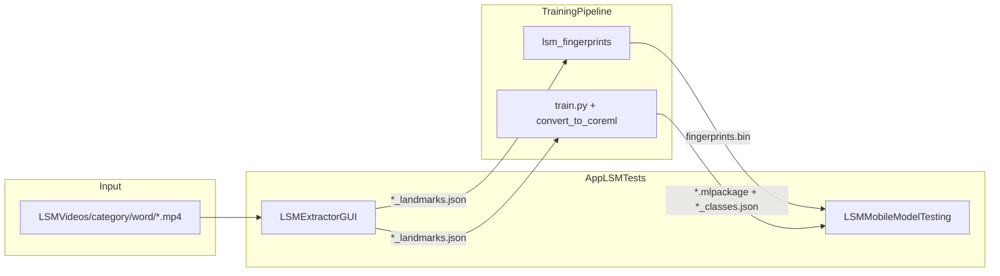

# AGENTS.md — AppLSMTests

> **Audience:** AI-assisted and agentic development. For human onboarding, see [README.md](./README.md).
>
> **Sibling repo:** [TrainingPipeline/AGENTS.md](../AGENTS.md) — Python Fase 1 + Fase 2 training pipeline.

This repo contains **Swift apps** for LSM (Lengua de Señas Mexicana):

- **LSMExtractorGUI** (macOS) — batch landmark extraction from video via Apple Vision
- **LSMMobileModelTesting** (iOS) — live camera inference (Fase 1 fingerprint+DTW or Fase 2 Core ML)

---

## Goals and success metrics

| Phase | Goal | Success metric |
|---|---|---|
| **Extractor** | Produce training-ready landmark JSON from organized videos | Correct `category/word/` discovery; mirrored output layout |
| **Fase 1 mobile** | On-device fingerprint matching | Parity with Python (`Phase1ParityCheck`); latency <200ms |
| **Fase 2 mobile** | On-device Core ML inference | Top-5 predictions; buffer fills to 85 frames before inference |

**Vocabulary:** 221 words defined in TrainingPipeline `themes.json`; extractor infers category/word from folder path only.

---

## Ecosystem architecture



---

## Critical invariants (do not break)

| Contract | Value / rule |
|---|---|
| Landmark vector | 135 dims/frame: `[0:42]` left hand, `[42:84]` right hand, `[84:135]` pose |
| Sequence length | 85 frames after interpolation (matches TrainingPipeline) |
| JSON frame keys | `frame`, `timestamp_ms`, `leftHand`, `rightHand`, `pose`; Y=0 at top (Swift applies `1.0 - y` on save) |
| Extractor input | `{root}/{category}/{word}/*.mp4` — no `themes.json` matching |
| Extractor output | `{outputRoot}/{category}/{word}/{base}_landmarks.json`, optional `{base}_overlay.mp4` |
| Manifest | `dataset_manifest.json` — schema in `Models.swift` (`DatasetManifest`) |
| Fase 1 binary | `fingerprints.bin` magic `0x4C534D46`, version 1 — loaded by `FingerprintMatcher.swift` |
| Fase 1 DTW | Sakoe-Chiba band `dtwRadius=10` — mirrors Python `DTW_RADIUS` |
| Fase 2 preprocessing | `SequencePreprocessor` on both Fase 1 and Core ML inference paths |
| Inference buffer | Circular buffer up to 170 frames; uses last 85; inference every 15 frames |
| Fase 2 class labels | Index `i` in model logits → `classes[i]`; label count must match output dimension (307 LSMOutput, 187 legacy) |
| Class label sources | Fase 1: embedded in `fingerprints.bin`; Fase 2: Core ML metadata `classes`, then `{classesBundleName}.json` from `AVAILABLE_MODELS` |
| Label JSON naming | `.mlpackage` stem may end in `_lsmoutput`; JSON fallback uses run stem: `runs_lsmoutput_cnn_classes.json` (not `runs_lsmoutput_cnn_lsmoutput_classes.json`) |
| Grading log file | `Documents/live_test_log.csv` on device — append-only; export via share sheet; **not** committed to git |
| Grading `session_id` | Persisted in `UserDefaults` key `grading_session_id`; stable across app launches until app reinstall |
| Model switch | Previous model stays active until new load succeeds; failed load shows overlay error and keeps prior model |

---

## File index — if task X, read Y

### LSMExtractorGUI (macOS)

| Task | Files |
|---|---|
| App entry | `LSMExtractorGUI/LSMExtractorApp.swift` |
| UI | `LSMExtractorGUI/ContentView.swift` |
| Vision + video I/O | `LSMExtractorGUI/LandmarkExtractor.swift` |
| Batch orchestration | `LSMExtractorGUI/BatchProcessor.swift` |
| Path discovery + manifest | `LSMExtractorGUI/DatasetScanner.swift` |
| Types (JSON, manifest, report) | `LSMExtractorGUI/Models.swift` |
| Xcode project | `LSMExtractorGUI/LSMExtractorGUI.xcodeproj/` |

### LSMMobileModelTesting (iOS)

| Task | Files |
|---|---|
| App entry | `LSMMobileModelTesting/LSMInferenceApp.swift` |
| UI (camera + predictions) | `LSMMobileModelTesting/ContentView.swift` |
| Inference pipeline | `LSMMobileModelTesting/LandmarkPipeline.swift` (`AVAILABLE_MODELS`, `loadClassLabels`, `ModelLoadPhase`, `pendingGrading`) |
| Live grading / CSV log | `LSMMobileModelTesting/GradingLog.swift` (`GradingSessionStore`) |
| Grading UI (Otra search, share) | `LSMMobileModelTesting/GradingViews.swift` |
| Camera + grading shell UI | `LSMMobileModelTesting/ContentView.swift` (`ModelLoadingOverlay`, grading panel) |
| Camera | `LSMMobileModelTesting/CameraManager.swift` |
| Fase 1 preprocessing | `LSMMobileModelTesting/SequencePreprocessor.swift` |
| Fase 1 fingerprint | `LSMMobileModelTesting/FingerprintExtractor.swift` |
| Fase 1 matching | `LSMMobileModelTesting/FingerprintMatcher.swift` |
| Shared constants | `LSMMobileModelTesting/LSMConstants.swift` |
| DEBUG parity check | `LSMMobileModelTesting/Phase1ParityCheck.swift` |
| Bundled models | `LSMMobileModelTesting/LSMMobileModelTesting/` — see [Bundled model artifacts](#bundled-model-artifacts-tracked-in-git) |
| Live test template | `TrainingPipeline/review/live_test_log_template.csv` |
| Golden fixture | `LSMMobileModelTesting/golden_sequence.json` |
| Xcode project | `LSMMobileModelTesting/LSMMobileModelTesting.xcodeproj/` |

---

## Technologies and dependencies

| Stack | Details |
|---|---|
| Language | Swift 5, SwiftUI |
| Vision | `VNDetectHumanHandPoseRequest`, `VNDetectHumanBodyPoseRequest` |
| Media | AVFoundation (extractor: reader/writer; mobile: AVCaptureSession) |
| ML | Core ML (Fase 2), custom DTW matcher (Fase 1) |
| Platforms | macOS 15.7+ (extractor), iOS 26.2+ deployment target (mobile) |
| IDE | Xcode with Apple SDKs |

**Build note:** Requires macOS + Xcode. Cannot build or run on Linux CI without a Mac runner.

---

## Common workflows

### Extract landmarks (macOS)

1. Open `LSMExtractorGUI/LSMExtractorGUI.xcodeproj` in Xcode
2. Select input root (`LSMVideos/`), output root (`LSMVideosOutput/`)
3. Optional: load existing `dataset_manifest.json`; toggle overlay off for JSON-only mode
4. Run **Procesar**

### Update Fase 1 on iOS

Production bin from LSMOutput (not the tiny sample from `generate_sample_bin.py`):

```bash
cd ../lsm_fingerprints
python build_db.py --dataset ../LSMOutput --output ./fingerprints.npz --export-bin ./fingerprints.bin --min-videos 2
```

Copy `fingerprints.bin` into LSMMobileModelTesting Xcode target. Do **not** commit it — it is gitignored and regenerated locally (see the repo README, Puesta en marcha). See [Phase 1 iOS validation checklist](#phase-1-ios-validation-checklist).

Baseline reference: [TrainingPipeline/AGENTS.md — Phase 1 baseline](../AGENTS.md#phase-1-baseline-lsmoutput)

### Add Core ML model (Fase 2)

1. Export from TrainingPipeline: `convert_to_coreml.py`
2. Copy `.mlpackage` into `LSMMobileModelTesting/LSMMobileModelTesting/`
3. Copy `classes.json` from the training run, renaming to `{run_stem}_classes.json` (e.g. `runs_lsmoutput_cnn/classes.json` → `runs_lsmoutput_cnn_classes.json`) — see [Class labels (iOS)](#class-labels-ios)
4. Register in `LandmarkPipeline.swift` → `AVAILABLE_MODELS`: set `bundleName` (`.mlpackage` stem) and `classesBundleName` (JSON stem without `.json`)
5. **Commit** the new or updated bundles in AppLSMTests (see [Bundled model artifacts](#bundled-model-artifacts-tracked-in-git))

### Run Fase 1 parity check

Build LSMMobileModelTesting in **Debug** on device/simulator — `Phase1ParityCheck` runs automatically against `golden_sequence.json`.

### Live grading on device (iOS)

In-app workflow for A/B model testing — see [Live grading / test logging (iOS)](#live-grading--test-logging-ios). Export `live_test_log.csv` via share sheet (↑) after a session.

---

## Prerequisites from TrainingPipeline

Before iOS Fase 1 validation, confirm TrainingPipeline Part A is complete:

| Artifact | Path | Status (2026-06-17) |
|---|---|---|
| Production `fingerprints.bin` | `TrainingPipeline/lsm_fingerprints/fingerprints.bin` | Built (307 classes, 1934 videos) |
| LOO baseline logged | [TrainingPipeline/AGENTS.md](../AGENTS.md#phase-1-baseline-lsmoutput) | Top-1 6.57%, Top-5 16.18% |
| Unit tests | `lsm_fingerprints/tests/test_all.py` | 8/8 passed |

Do **not** use `generate_sample_bin.py` for device validation — it only contains 2 dummy classes.

---

## Phase 1 iOS validation checklist

Execute on **macOS + Xcode + physical device** (recommended for camera latency).

### Integration status (2026-06-06)

| ID | Item | Status |
|---|---|---|
| B1 | Production `fingerprints.bin` in app folder | Local only — gitignored; generate with `build_db.py` or `generate_sample_bin.py` |
| B2 | Debug parity + load log | Offline OK — golden max diff 0.0; confirm `✓ Parity check passed` + `307 clases, 1934 videos` on Debug build |
| B3 | Live test matrix | **Pending device** — procedure in README |
| B4 | Latency from debug panel | **Pending device** — Cosine/DTW split wired; Python desktop ~930 ms reference |
| B5 | Release smoke | **Pending device** — one Release build after Debug passes |

**Code changes applied (latency mitigation):**

- Async `fingerprints.bin` parse in `LandmarkPipeline.loadModel` (background queue + loading UI)
- Fingerprint `match()` on detached task; UI updates on `@MainActor`
- `LSMConstants.dtwRadius = 10` (Sakoe-Chiba band in `FingerprintMatcher.dtwDistance`)
- Debug panel: Cosine ms + DTW ms columns

**Code changes applied (class labels, 2026-06-22):**

- `LSMModel.classesBundleName` maps each Fase 2 backend to its bundled `*_classes.json`
- `loadClassLabels()` in `LandmarkPipeline.swift`: metadata key `classes` (not `n_classes`), then explicit JSON fallback
- Fixes live predictions showing `clase_N` when label count is below model output dimension (e.g. legacy 187-class JSON loaded for a 307-class model)

**Code changes applied (model loading UI, grading, 2026-06-22):**

- `ModelLoadPhase` overlay: progress bar, success checkmark, error + revert to previous model on failure
- `pendingGrading` / `GradingSessionStore`: Top-5 selectable grading, **Otra** search with confirm step, CSV append to `Documents/live_test_log.csv`
- `GradingLog.swift` requires `import Combine` — `GradingSessionStore` uses `ObservableObject` / `@Published` (build fails without it)

### B1 — Copy production bin

- [x] Source: `../lsm_fingerprints/fingerprints.bin` (from LSMOutput build)
- [x] Copy to `LSMMobileModelTesting/LSMMobileModelTesting/fingerprints.bin` (synchronized root group auto-bundles)
- [x] Leave `fingerprints.bin` untracked (gitignored) after copy or rebuild
- [x] Load path: `FingerprintMatcher.init(bundleName:)`

### B2 — Debug parity check

- [x] Offline: `golden_sequence.json` fingerprint max diff **0.0** (Python reference)
- [x] Build **Debug** on Mac — confirm console: `✓ Parity check passed (max diff …)`
- [x] Console: `✓ Fingerprint DB: 307 clases, 1934 videos`
- [x] If fail: regenerate fixture via `export_fixtures.py`; sync `LSMConstants.swift` ↔ `constants.py`

### B3 — Live Fase 1 smoke test

- [ ] Select **Fase 1 — Fingerprint+DTW** in model picker
- [ ] Test matrix: Festividades, Personajes_Historicos, Colores, Familia, Abecedario (2–3 signs each)
- [ ] Record Top-1 label, confidence %, Inferencia/Cosine/DTW ms per sign
- [ ] Top-1 confidence above `CONFIDENCE_THR` (0.15) for best LOO categories

### B4 — Latency check

- [ ] Read **Inferencia**, **Cosine**, **DTW** from debug panel
- [ ] Target: total <200ms per cycle (goal <100ms)
- [x] Mitigations in place if over budget (async load, background match, DTW radius)

### B5 — Decision gate

| LOO Top-1 (Python) | On-device | Next action |
|---|---|---|
| <40% (current 6.57%) | Poor matches expected | Fix TrainingPipeline preprocessing/data first |
| 40–60% | Partial matches | Category-scoped bins or weak-class review |
| ≥60% | Stable matches | Phase 1 baseline met; prioritize Fase 2 TCN comparison |

Human-friendly steps: [README — Validar Fase 1 en dispositivo](./README.md#validar-fase-1-en-dispositivo-después-del-baseline-python)

---

## Phase 2 iOS validation checklist

After TrainingPipeline produces LSMOutput-trained `.mlpackage` (see [TrainingPipeline/README — Integrar modelos Fase 2](../README.md#integrar-modelos-fase-2-entrenados-en-lsmoutput)).

### C1 — Copy Core ML artifact

- [x] Copy `exports/*_lsmoutput.mlpackage` + matching `classes.json` into `LSMMobileModelTesting/LSMMobileModelTesting/` (2026-06-22)
- [x] Register in `AVAILABLE_MODELS` (`LandmarkPipeline.swift`) with val_acc in description and `classesBundleName`
- [x] Fase 1 `fingerprints.bin` refreshed from TrainingPipeline
- [x] Class label mapping wired (`classesBundleName` per backend; verified live on device)
- [x] **Commit** `.mlpackage/` and matching `*_classes.json` after copy or retrain (`fingerprints.bin` stays local)

See [Bundled model artifacts](#bundled-model-artifacts-tracked-in-git) for the full file list and update workflow.

### C2 — Load smoke

- [ ] Debug build: console shows correct class count (307 for LSMOutput models, 187 for legacy)
- [ ] Debug panel **Clases** matches expected count when switching models
- [ ] Console: `✓ Clases desde metadata 'classes': 307` or `✓ Clases desde runs_lsmoutput_*_classes.json: 307`
- [ ] No `loadError` in predictions panel; no `clase_N` placeholders in Top-5
- [ ] Metadata `val_acc` matches TrainingPipeline log

### C3 — Live smoke

- [ ] Test 5–10 signs from `reports/class_overlap.json` intersection
- [ ] Top-1 shows human-readable sign names (not `clase_N`)
- [ ] Top-1 appears with confidence >15%

### C4 — Latency

- [ ] Read **Inferencia** ms from debug panel (Core ML path)
- [ ] Target: <200 ms per cycle

### C5 — Release smoke

- [ ] One Release build; model loads and predicts

### Head-to-head A/B (Fase 1 vs Fase 2)

- [ ] Same session, switch model picker across all 5 backends
- [ ] Use in-app **grading panel** (Top-5 + **Otra**) — logs append to `Documents/live_test_log.csv`; export via share sheet (↑)
- [ ] Optional cross-check: [TrainingPipeline/review/live_test_log_template.csv](../review/live_test_log_template.csv) column layout (app CSV is a superset with all Top-5 guesses)
- [ ] Minimum 10-sign matrix from `class_overlap.json` (Festividades, Personajes, Colores, Familia, Abecedario)
- [ ] Report to [TrainingPipeline/AGENTS.md — iOS validation](../AGENTS.md#ios-validation-results)

**Preprocessing parity (2026-06-06):** Fase 2 Core ML inference now uses `SequencePreprocessor.prepareSequence()` — matches Fase 1 and Python training pipeline.

---

## Live-testing roadmap

Mirrors [TrainingPipeline/AGENTS.md — Live-testing roadmap](../AGENTS.md#live-testing-roadmap). Execute on Mac device; primary log file: **`Documents/live_test_log.csv`** (export from app).

### Loop A — Measure (weeks 1–2)

- Run A/B matrix using in-app grading UI; export CSV per session
- Compare live Top-1 vs Python val per backend (gap analysis); derive `correct_yes_no` offline from `selected_sign` vs ground-truth sign performed
- Tag failures: wrong class, low confidence, no detection, latency timeout

### Loop B — Diagnose (ongoing)

- Cross-reference live failures with `TrainingPipeline/reports/error_analysis.json`
- Prioritize weak categories: Abecedario, Actividades_Cotidianas, Familia

### Loop C — Data collection (weeks 2–4)

- Record live-failure signs via LSMExtractorGUI (multiple performers/angles)
- Feed expanded LSMOutput back to TrainingPipeline

### Loop D — Model iteration (weeks 4–8)

- Retrain CNN/TCN on expanded data; compare TCN vs CNN live Top-1 for production default
- Category-scoped Fase 1 bins for weak categories

### Loop E — Production hardening

- Mac Core ML predict verification; optional `Phase2ParityCheck.swift`
- Default model: CNN unless live tests favor TCN
- On-demand model download if bundle size blocks TestFlight

### Success metrics (8-week targets)

| Metric | Python val | Live target |
|---|---|---|
| CNN Top-1 | 47.16% | >35% on device |
| Inference latency | ~0.2 ms/video (Python) | <200 ms on device |
| Festividades | 24% Fase 1 LOO | >40% with best backend |

---

## Model switching overlay (iOS)

When the user picks a different backend in `ContentView`, `LandmarkPipeline.loadModel` loads asynchronously **without** tearing down the active model until the new one succeeds.

| `ModelLoadPhase` | UI |
|---|---|
| `.loading(name, progress)` | Full-screen overlay, progress bar 0–100%, model name |
| `.succeeded(name, warning?)` | Green checkmark, «Modelo cargado correctamente», optional warning (e.g. label count mismatch) |
| `.failed(name, message, keptModelName?)` | Error text; prior model remains active (`keptModelName`) |
| `.idle` | Overlay hidden |

**Progress sources:** Fase 1 — staged `FingerprintMatcher` parse (`progress` callback); Fase 2 — locate bundle → `MLModel` load on background queue → resolve class labels.

**Implementation:** `ModelLoadPhase` + `ModelLoadingOverlay` in `ContentView.swift`; `loadModel` / `commitLoadedState` in `LandmarkPipeline.swift`.

---

## Live grading / test logging (iOS)

On-device workflow to score model predictions during live testing. Replaces manual CSV entry for the fields the app captures automatically.

### User flow

1. Buffer fills → inference runs → **Top-5** frozen in `pendingGrading` (one prompt per inference; no overwrite until user acts or resets).
2. User taps a guess **or** **Otra** → searchable list of all `availableClassLabels` for the active model → **confirm** screen → log.
3. Row appended to CSV; `pendingGrading` cleared; wait for next inference.
4. **Reset (↺)** clears buffer **and** pending grading options.
5. **Share (↑)** exports `live_test_log.csv`; **Trash** deletes all rows (alert shows count; **No** is cancel/default).

### CSV location and schema

| Property | Value |
|---|---|
| Path | `Documents/live_test_log.csv` (device sandbox; export via share sheet) |
| `session_id` | `UserDefaults` key `grading_session_id` — format `YYYY-MM-DD-xxxxxxxx`, stable until app reinstall |
| Git | **Do not commit** — generated on device per tester |

**Columns** (header written on first create):

```
session_id, timestamp, model_name, inference_ms,
guess1, conf1_pct, guess2, conf2_pct, guess3, conf3_pct, guess4, conf4_pct, guess5, conf5_pct,
selected_sign, selection_source
```

| `selection_source` | Meaning |
|---|---|
| `top_pick` | User tapped one of the Top-5 buttons |
| `otra_search` | User picked via **Otra** search + confirm |

**Relation to TrainingPipeline template:** [live_test_log_template.csv](../review/live_test_log_template.csv) uses fewer columns (`sign`, `category`, `backend`, `correct_yes_no`, …). App CSV is richer (all Top-5 + confidences). Join or post-process offline for `correct_yes_no` by comparing `selected_sign` to the sign performed on camera.

### Implementation files

| File | Role |
|---|---|
| `GradingLog.swift` | `GradingRound`, `GradingSelectionSource`, `GradingSessionStore` |
| `GradingViews.swift` | `OtraSignSearchSheet`, `GradingOptionButton`, `ShareSheet` |
| `LandmarkPipeline.swift` | `pendingGrading`, `offerGradingRound`, `acknowledgeGradingRound` |
| `ContentView.swift` | Grading panel, export/delete, wires `submitGradingSelection` |

### Build note (`GradingLog.swift`)

`GradingSessionStore` conforms to `ObservableObject` and uses `@Published`. The file **must** include `import Combine` (in addition to `Foundation`). Without it, Xcode reports errors on `@Published` / `ObservableObject`. This was fixed via Xcode coding assistant (2026-06-22).

---

## Class labels (iOS)

Prediction text in **LSMMobileModelTesting** maps model output index `i` to `classes[i]`. If the label list is shorter than the model output, the UI shows a placeholder `clase_N` (implemented in `LandmarkPipeline.swift` and `FingerprintMatcher.swift`).

### Sources by backend

| Backend | Label source | Expected count |
|---|---|---|
| Fase 1 — Fingerprint+DTW | Class names appended to `fingerprints.bin` after sequences | 307 |
| Fase 2 — CNN / TCN / 3D CNN | Core ML user metadata `classes` (JSON array), else bundled `runs_lsmoutput_*_classes.json` | 307 |
| Fase 2 — Legacy v1 | Core ML metadata `classes`, else `classes.json` | 187 |

### `AVAILABLE_MODELS` registration

Each `LSMModel` entry uses:

| Field | Meaning |
|---|---|
| `bundleName` | Resource stem for `.mlpackage` / `.bin` (e.g. `runs_lsmoutput_cnn_lsmoutput`) |
| `classesBundleName` | Resource stem for fallback JSON **without** extension (e.g. `runs_lsmoutput_cnn_classes` → `runs_lsmoutput_cnn_classes.json`). Omit / `nil` for Fase 1 (labels in bin). |

Current mapping:

| `bundleName` | `classesBundleName` | Bundled JSON |
|---|---|---|
| `fingerprints` | — | (embedded in bin) |
| `runs_lsmoutput_cnn_lsmoutput` | `runs_lsmoutput_cnn_classes` | `runs_lsmoutput_cnn_classes.json` |
| `runs_lsmoutput_tcn_lsmoutput` | `runs_lsmoutput_tcn_classes` | `runs_lsmoutput_tcn_classes.json` |
| `runs_lsmoutput_3dcnn_lsmoutput` | `runs_lsmoutput_3dcnn_classes` | `runs_lsmoutput_3dcnn_classes.json` |
| `coreml_models` | `classes` | `classes.json` |

**Naming rule:** TrainingPipeline exports `.mlpackage` with suffix `_lsmoutput` (export name), but `classes.json` is copied from the **run folder** (`runs_lsmoutput_cnn/`, etc.) and renamed `{run_stem}_classes.json`. Do **not** name the JSON after the full `.mlpackage` stem unless you also set `classesBundleName` accordingly.

### Load order (`loadClassLabels` in `LandmarkPipeline.swift`)

1. Core ML metadata — key exactly `classes` or ending in `.classes` (excludes `n_classes`)
2. Bundle JSON — `classesBundleName` from `AVAILABLE_MODELS`
3. Derived fallback — strip trailing `_lsmoutput` from `bundleName` → `{base}_classes.json`
4. Last resort — `{bundleName}_classes.json`

Fase 1 bypasses this path; `FingerprintMatcher` reads class names from the binary header.

### Troubleshooting `clase_N` in live tests

| Symptom | Likely cause | Fix |
|---|---|---|
| `clase_187`+ on CNN/TCN/3DCNN | Wrong JSON loaded (e.g. legacy `classes.json` with 187 entries for a 307-class model) | Set `classesBundleName` in `AVAILABLE_MODELS`; confirm `runs_lsmoutput_*_classes.json` is in the app bundle |
| Debug **Clases** shows 187 on LSMOutput model | Same as above | Rebuild after copying correct JSON; check Xcode console for which file loaded |
| All predictions `clase_N` | Empty or truncated label list | Verify metadata parse log; confirm JSON is a `[String]` array |
| Wrong sign name but not `clase_N` | Label index order differs from training | Regenerate `classes.json` from the same TrainingPipeline run as the `.mlpackage` |

---

## Bundled model artifacts (tracked in git)

Inference bundles live in **`LSMMobileModelTesting/LSMMobileModelTesting/`** and are **committed to this repo** so clones and CI can run the app without retraining. Expected total ~97 MB.

| File / folder | Backend |
|---|---|
| `fingerprints.bin` | Fase 1 — Fingerprint+DTW (307 classes) |
| `runs_lsmoutput_cnn_lsmoutput.mlpackage/` | Fase 2 — CNN |
| `runs_lsmoutput_tcn_lsmoutput.mlpackage/` | Fase 2 — TCN |
| `runs_lsmoutput_3dcnn_lsmoutput.mlpackage/` | Fase 2 — 3D CNN |
| `coreml_models.mlpackage/` | Fase 2 — Legacy v1 (187 classes) |
| `runs_lsmoutput_*_classes.json` | Class label fallbacks for LSMOutput models (307 labels each) |
| `classes.json` | Legacy Core ML class labels (187) |

See [Class labels (iOS)](#class-labels-ios) for the full `bundleName` ↔ JSON mapping and load order.

### When to update and commit

```bash
IOS=LSMMobileModelTesting/LSMMobileModelTesting
TP=..

cp "$TP/lsm_fingerprints/fingerprints.bin" "$IOS/"
cp -r "$TP/exports/runs_lsmoutput_cnn_lsmoutput.mlpackage" "$IOS/"
cp -r "$TP/exports/runs_lsmoutput_tcn_lsmoutput.mlpackage" "$IOS/"
cp -r "$TP/exports/runs_lsmoutput_3dcnn_lsmoutput.mlpackage" "$IOS/"
cp "$TP/runs_lsmoutput_cnn/classes.json" "$IOS/runs_lsmoutput_cnn_classes.json"
cp "$TP/runs_lsmoutput_tcn/classes.json" "$IOS/runs_lsmoutput_tcn_classes.json"
cp "$TP/runs_lsmoutput_3dcnn/classes.json" "$IOS/runs_lsmoutput_3dcnn_classes.json"
```

Then in **AppLSMTests**:

```bash
git add LSMMobileModelTesting/LSMMobileModelTesting/*.mlpackage
git add LSMMobileModelTesting/LSMMobileModelTesting/runs_lsmoutput_*_classes.json
git commit -m "Update bundled inference artifacts from TrainingPipeline"
```

Also update `AVAILABLE_MODELS` (`bundleName`, `classesBundleName`, description) in `LandmarkPipeline.swift` if val metrics or export names changed.

### Agent rules

- **Do** set `classesBundleName` when registering a new Fase 2 backend — must match the copied `*_classes.json` stem
- **Do** commit updated `.mlpackage/` directories and matching `*_classes.json` when TrainingPipeline produces new exports
- **Don't** commit `fingerprints.bin` — generate it locally (`generate_sample_bin.py` or `build_db.py`)
- **Do** keep TrainingPipeline intermediate artifacts (`fingerprints.npz`, `runs_lsmoutput_*/`, `exports/`) gitignored — the iOS `.mlpackage` copy is what gets tracked
- **Don't** use Git LFS unless the team explicitly adopts it; plain git is the current policy
- **Don't** commit Xcode build output (`DerivedData/`, `*.ipa`) — see `.gitignore`

---

## Next steps / backlog

1. **Complete B3–B5 on Mac/device** — Fase 1 live matrix, latency, Release smoke
2. **Complete C2–C5 on Mac/device** — load smoke per backend, live A/B via grading UI, latency, Release smoke
3. Keep `golden_sequence.json` in sync when Fase 1 constants change
4. Optional: `Phase2ParityCheck.swift` — golden logits vs Python on fixed sequence
5. Optional: add `category` / `correct_yes_no` columns to app CSV or post-export script
6. Report device results to [TrainingPipeline/AGENTS.md — iOS validation](../AGENTS.md#ios-validation-results)

See [Live-testing roadmap](#live-testing-roadmap) for iterative accuracy improvement.

See also [TrainingPipeline/AGENTS.md — Handoff to AppLSMTests](../AGENTS.md#handoff-to-applsmtests) for Python-side workflow.

---

## Agent conventions

### Do

- Match existing Swift naming, SwiftUI patterns, and minimal diff scope
- Preserve landmark JSON format compatibility with `TrainingPipeline/dataset.py`
- **Commit** updated `.mlpackage/` and `*_classes.json` after TrainingPipeline handoff; leave `fingerprints.bin` untracked (see [Bundled model artifacts](#bundled-model-artifacts-tracked-in-git))
- Update AGENTS.md and README.md when changing contracts, UI workflows, or manifest schema
- Check sibling [TrainingPipeline/AGENTS.md](../AGENTS.md) for cross-repo changes

### Don't

- Commit Xcode user state, signing credentials, or build artifacts (see `.gitignore`)
- Reintroduce `themes.json` matching in the extractor
- Create new `.md` files — only `README.md` and `AGENTS.md` are tracked

### Don't — signing and security

Never stage Xcode user-specific or credential-bearing files:

| Pattern | Reason |
|---|---|
| `**/xcuserdata/` | Per-user schemes, local signing overrides |
| `*.xcuserstate`, `*.xccheckout`, `*.moved-aside` | Xcode user state |
| `*.mobileprovision`, `*.provisionprofile` | Provisioning profiles |
| `*.cer`, `*.p12`, `*.p8` | Certificates and private keys |
| `Secrets.xcconfig`, `*.secrets.xcconfig`, `.env` | Local secrets / API keys |
| `DerivedData/`, `build/`, `*.ipa`, `*.dSYM.zip` | Build artifacts with signing metadata |

**project.pbxproj:** Do not modify or commit `DEVELOPMENT_TEAM`, `CODE_SIGN_IDENTITY`, `PROVISIONING_PROFILE_SPECIFIER`, or entitlements changes unless the user explicitly requests it. The project currently contains team ID `6Q5574XLD8` — do not rewrite signing settings during unrelated tasks.

If Xcode creates `xcuserdata/` locally, leave it untracked. Do **not** `git add -f` ignored paths.

---

## Documentation maintenance protocol

After completing a task that changes architecture, contracts, workflows, or backlog status:

1. Update **this repo's** `AGENTS.md`
2. Update **this repo's** `README.md` if human-facing behavior changed
3. Check whether [TrainingPipeline/AGENTS.md](../AGENTS.md) needs the same invariant or cross-link update
4. Do **not** add other markdown files

| Change type | Update |
|---|---|
| New Swift file / renamed module | File index here; structure in README |
| Extractor or manifest schema change | Invariants in both AGENTS.md; examples in both READMEs |
| iOS inference behavior | File index + README usage section; [Class labels (iOS)](#class-labels-ios), [Live grading](#live-grading--test-logging-ios), [Model switching overlay](#model-switching-overlay-ios) as needed |
| Grading CSV schema change | [Live grading](#live-grading--test-logging-ios) + README grading section |
| Completed backlog item | Remove or mark done in both AGENTS.md |
| Cross-repo integration | Ecosystem diagram + sibling cross-link in both files |
